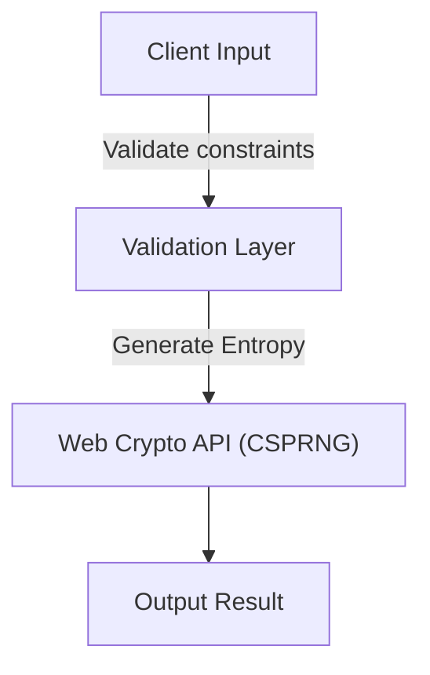

# Mermaid & README Documentation Hardening

A reference guide for engineering documentation standards and GitHub-compatible Mermaid diagrams across all repositories under `EF361`.

## Strict Mermaid Syntax Rules for GitHub

GitHub's Mermaid markdown renderer crashes with a `Parse error` if node or transition labels contain unquoted punctuation (such as parentheses, brackets, colons, or commas).

### 1. Always Quote Node Definitions
Wrap all node labels inside double quotes:

- ❌ **Invalid**: `E[Process Output Format(s)]`
- ✅ **Valid**: `E["Process Output Format(s)"]`

- ❌ **Invalid**: `C[Web Crypto API (Entropy Generation)]`
- ✅ **Valid**: `C["Web Crypto API (Entropy Generation)"]`

- ❌ **Invalid**: `A[API: Fast Response]`
- ✅ **Valid**: `A["API: Fast Response"]`

### 2. Always Quote Transition Edge Labels
Transition texts with special characters or parentheses must also be enclosed in quotes:

- ❌ **Invalid**: `A -->|Valid Parameters (v2)| B`
- ✅ **Valid**: `A -->|"Valid Parameters (v2)"| B`

### 3. Diagram Headers
- Use `graph TD` or `flowchart TD` for top-to-bottom architectures.
- Use `graph LR` or `flowchart LR` for sequential processing pipelines.

## Required Recruiter-Grade README Sections

Every repository maintained or created under `EF361` should contain:

1. **Title & Dynamic Badges**:
   - Dynamic shields.io badges for tech stack, CI status, license, and live demo.
2. **Executive Summary**:
   - 1-2 clear, high-impact sentences describing the problem solved and core value.
3. **Key Features**:
   - Bulleted list highlighting architectural design decisions, performance, security, and edge-case handling.
4. **Architecture & Workflow**:
   - A Mermaid diagram following the strict quoting rules above.
5. **Tech Stack Breakdown**:
   - Categorized list of languages, frameworks, libraries, and dev tooling.
6. **Quickstart / Installation**:
   - Copy-pasteable shell commands (`git clone`, `npm install`, `npm run dev`, etc.).
7. **About the Author**:
   - Professional closing linking Alicia Goh's portfolio and GitHub.
