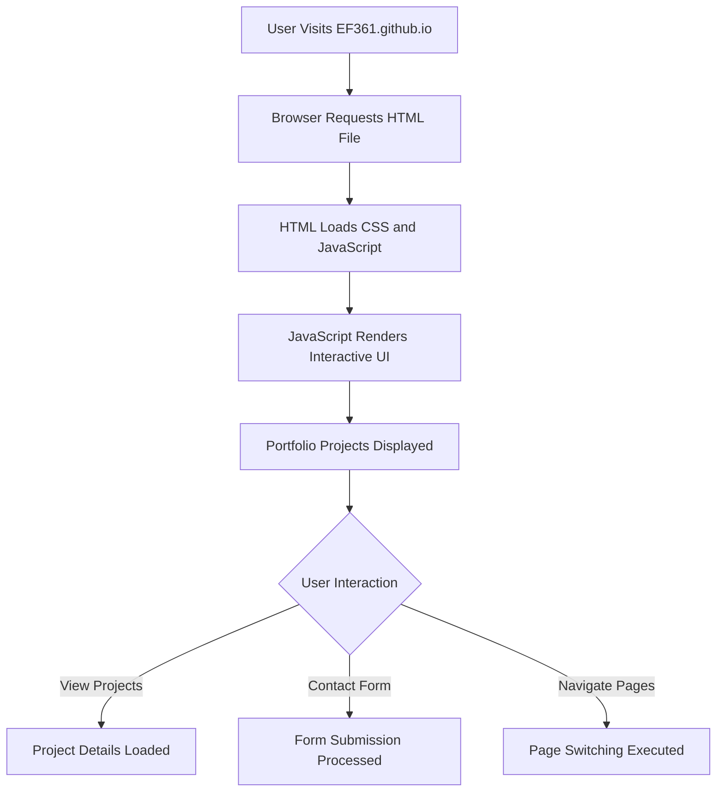

# EF361.github.io  
  
  
  

## 🌟 Executive Summary  
EF361.github.io is a sleek, high-performance personal web portfolio built to showcase Alicia Goh's expertise as an AI & Software Engineer. This responsive web application highlights cutting-edge project work and professional achievements in a modern, accessible design – engaging users across all devices and platforms.

## ✨ Key Features  
- **Responsive Design**: Fully optimized for desktop, tablet, and mobile devices.  
- **Interactive Components**: JavaScript-driven animations and dynamic content delivery for an engaging user experience.  
- **Fast Performance**: Minimalist design paired with optimized asset loading ensures quick page loading times.  
- **SEO-Friendly**: Crafted with built-in SEO optimizations for search engine discoverability.  
- **Modular Codebase**: Clean, reusable, and maintainable structure leveraging modern JavaScript concepts.  

## 🛠️ Architecture & Workflow  



## 💻 Tech Stack & Tools  
- **Frontend**: JavaScript (ES6+), HTML5, CSS3  
- **Styling**: Custom CSS with responsive grid and flexbox layouts  
- **Workflow Tools**:  
  - VS Code (development)  
  - GitHub Pages (hosting)  
  - Chrome Developer Tools (debugging and performance tuning)  

## 🚀 Quickstart / Installation  

Follow the simple steps below to deploy and run EF361.github.io locally:  

1. **Clone the Repository**:  
   ```bash
   git clone https://github.com/EF361/EF361.github.io.git
   cd EF361.github.io
   ```  

2. **Open Locally in Browser**:  
   Open the `index.html` file in your preferred web browser:  
   ```bash
   open index.html
   ```  

3. **(Optional) Modify and Serve Locally**:  
   Install a lightweight HTTP server like `http-server` to view changes in real-time:  
   ```bash
   npm install -g http-server
   http-server
   ```  
   Access it in your browser at `http://localhost:8080`.  

## 📄 License  
This repository is licensed under the **MIT License**. Feel free to use and modify the code for your personal and professional projects.  

---  
Built and maintained with ❤️ by Alicia Goh (EF361), showcasing expertise in cutting-edge software engineering practices.