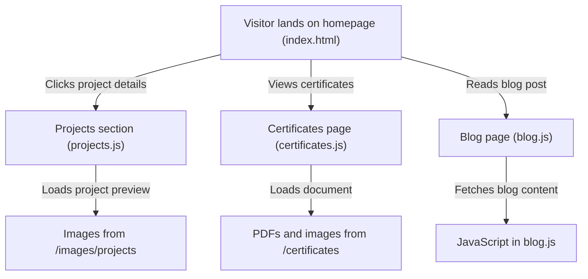

# EF361.github.io

A personal portfolio and blog showcasing projects, achievements, and skills.


[Live Demo](https://alicia-goh-portfolio.vercel.app)
<!-- Screenshot: add docs/screenshot.png -->

## Overview

This repository contains the code for Alicia Goh's personal portfolio and blog. It serves as a centralized showcase of projects, certificates, and experiences, as well as a platform for blogging about topics of interest.

## Features

- **Portfolio Section**: Highlight notable projects with images and details (e.g., `images/projects/`).
- **Certificates Gallery**: Display earned certifications in categorized folders (e.g., `certificates/`).
- **Blog Posts**: Share thoughts and insights via `blog.html` and `blog.js`.
- **Responsive Design**: Adjusts layout for various screen sizes (`style.css`).
- **Firebase Integration**: Real-time storage and authentication via `firebase-config.js` and `firestore.rules`.
- **Custom Theme Switching**: Switch between light and dark modes using `theme.js`.

## How It Works



## Tech Stack

- **Language**: JavaScript (ES6)
- **Styling**: CSS
- **Backend Services**: Firebase

## Getting Started

### Prerequisites

- Node.js installed on your machine.

### Steps

1. Clone the repository:

   ```bash
   git clone https://github.com/EF361/EF361.github.io.git
   ```

2. Navigate to the project directory:

   ```bash
   cd EF361.github.io
   ```

3. Open the `index.html` file in your browser or deploy to a static hosting platform.

## Project Structure

```
EF361.github.io/
├── .gitignore
├── admin.html
├── blog.html
├── blog.js
├── certificates/
│   ├── create-an-adventure-game-using-python.pdf
│   ├── dean's award/
│   │   ├── Dean's Award Sem 1 20222023.pdf
│   │   └── Dean's Award Sem 2 20222023.pdf
│   └── google-ai-essentials.pdf
├── firebase-config.js
├── images/
│   └── projects/
│       ├── epf-calculator/
│       │   ├── dashboard.png
│       │   └── preview.png
│       └── kind-borg/
│           ├── architecture-flowchart.gif
│           └── preview.png
├── index.html
├── projects.js
├── style.css
├── theme.js
└── vercel.json
```

## Testing

Run tests using the test harness script located in `mcp/test-harness.js`:

```bash
node mcp/test-harness.js
```

This tests specific functionalities related to modular components (e.g., `mcp/utils/`).

## Roadmap

- [ ] Add CI/CD workflow for deployment.
- [ ] Include a metadata SEO optimization script.
- [ ] Document testing procedures in detail.
- [ ] Optimize images for faster page load times.

---

Built by [Alicia Goh](https://github.com/EF361)