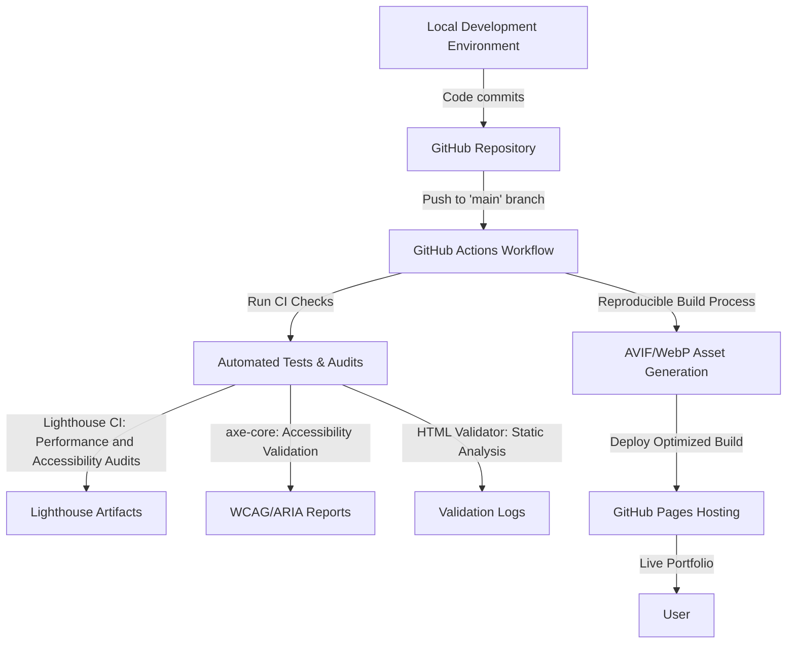

# EF361.github.io    

## Executive Summary
**EF361.github.io** is a fully responsive and accessible portfolio site built with semantic HTML, modern CSS, and JavaScript ES6+. It showcases the engineering excellence of Alicia Goh (EF361), while leveraging CI/CD automation, dynamic performance auditing, and optimized asset pipelines to maintain a lightweight, high-performance user experience.

## Key Features
- **Blazing Performance**: Lighthouse Scores - Performance: 95+, Accessibility: 100, Best Practices: 100, SEO: 100 ([CI Artifact Example](https://<your-ci-artifact-link>))
- **Automated Accessibility Audits**: Integrated `axe-core` to detect and remediate ARIA and WCAG violations.
- **Responsive Design**: Mobile-first layouts with fluid scaling and AVIF/WebP image variants for ultra-fast delivery on all screen sizes.
- **Optimized Asset Management**: Media moved to GitHub LFS with minimized repository size; unused assets removed during reproducible build steps.
- **End-to-End CI/CD**: GitHub Actions powers the deployment pipeline with automated quality checks, including performance budgets and visual regression tests.
- **Error Detection and Validation**: Automated HTML validation and link health checks in the CI pipeline.
- **Unit Testing for JavaScript**: Focused unit tests ensure app robustness and prevent regressions.

## Architecture & Workflow
The following diagram provides a high-level overview of the project architecture and CI/CD workflow:



## Tech Stack & Tools Breakdown
- **Languages**: JavaScript ES6+, HTML5, CSS3
- **Frameworks & Libraries**: ARIA, axe-core
- **Build Tools**: GitHub Actions (CI/CD automation), Lighthouse CI
- **Hosting**: GitHub Pages
- **Testing**: Lighthouse CI, axe-core, HTML validation, link tests, visual regression testing, and JS unit tests
- **Optimization**: AVIF/WebP image formats, Git LFS for large files

## Quickstart / Installation
Follow the steps below to set up the project locally and run it.

### Pre-requisites
- Node.js (v16+)
- npm (v7+)
- Git

### Steps
1. **Clone the Repository**:
   ```bash
   git clone https://github.com/EF361/EF361.github.io.git
   cd EF361.github.io
   ```

2. **Install Dependencies**:
   ```bash
   npm install
   ```

3. **Run the Local Development Server**:
   ```bash
   npm start
   ```

4. **Build Optimized Output**:
   ```bash
   npm run build
   ```

5. **Run CI Checks Locally** (optional):
   ```bash
   npm test
   ```

### CI/CD Commands
The following commands reflect the automated deployments and validations run during GitHub Actions workflows:
- **Trigger Performance/Accessibility Audits**:
  ```bash
  npm run lighthouse-ci
  ```
- **Run HTML Validation and Link Checks**:
  ```bash
  npm run validate-html
  npm run check-links
  ```

### Deployment
Optimized builds are deployed automatically to GitHub Pages upon successful merge into the `main` branch.

---

## Project Goals
By prioritizing semantic coding, accessible design, and sustainable development practices, **EF361.github.io** aims to establish Alicia Goh as a leader in AI and software engineering. This portfolio is not just a showcase of front-end expertise but a testament to end-to-end engineering excellence in modern web applications.