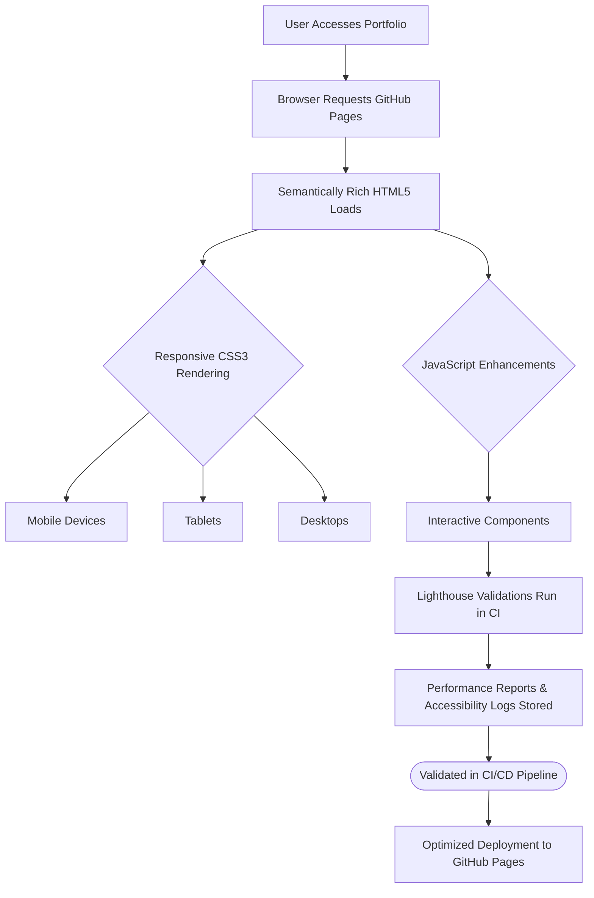

# EF361.github.io        

### 🌐 **Dynamic Portfolio Showcasing Excellence in AI & Software Engineering**

---

## 📄 **Executive Summary**
EF361.github.io is a high-performing, standards-compliant portfolio that demonstrates semantic markup, responsive layouts, and accessibility-first design while leveraging automated CI workflows for validation and analytical insights. This project exemplifies excellence in web development with a focus on modern technologies, best practices, and user experience.  

---

## ✨ **Key Features**
- **Semantic Markup**: Emphasis on clean, maintainable HTML5 and ARIA landmarks for enhanced accessibility.
- **Responsive Design**: Fluid, modern layouts optimized for all devices using CSS3 media queries and grid systems.
- **Performance Optimization**:
  - Leveraged Lighthouse for measurable improvements in speed, accessibility, and SEO ratings.
  - Implemented responsive image variants, lazy loading, and explicit image dimensions to prevent layout shifts.
- **Accessibility Compliance**: Validated with axe-core for color contrast, reduced motion, keyboard navigation, and screen-reader compatibility.
- **GitHub Actions CI**: Automated workflows for Lighthouse testing, performance budgets, and accessibility validation in every commit.
- **Server-Side Security Awareness**: Reinforced that client-side validation and CAPTCHA are supplementary to backend security measures.
- **Optimized Static Assets**: Removed oversized/duplicate media and added proper cache headers for faster loading times.
- **Deployability on GitHub Pages**: Instantly shareable as a lightweight static site tailored for professional branding.

---

## 📚 **Architecture & Workflow**



---

## ⚡ **Tech Stack & Tools**
| **Category**           | **Technology**                                    |
|-------------------------|--------------------------------------------------|
| **Languages**          | JavaScript ES6+, HTML5, CSS3                     |
| **Performance Tools**   | Lighthouse, axe-core, Lighthouse CI             |
| **Build & Deployment**  | GitHub Pages, GitHub Actions                    |
| **Accessibility Tests** | axe-core, ARIA rules implementation             |
| **Version Control**     | Git + GitHub                                    |

---

## 🚀 **Quickstart / Installation**
Clone the repository and serve the portfolio locally to preview or contribute. Follow the instructions below:

1. **Clone Repository**:
   ```bash
   git clone https://github.com/EF361/EF361.github.io.git
   cd EF361.github.io
   ```

2. **Serve Locally** (requires a local web server):
   ```bash
   # Use Python to serve locally (for developers with Python installed)
   python -m http.server
   ```

3. **Browser Access**:
   Open `http://localhost:8000` in your browser to access the portfolio locally.

4. **Run Lighthouse Tests Locally**:
   Install Lighthouse globally and test:
   ```bash
   npm install -g lighthouse
   lighthouse http://localhost:8000
   ```

5. **Deploy Changes**:
   Push your validated changes to the `main` branch for automatic GitHub Pages deployment:
   ```bash
   git add .
   git commit -m "Your descriptive commit message"
   git push origin main
   ```

---

## 🔍 **Ongoing Enhancements**
- [ ] Automate performance budgets using Lighthouse CI.
- [ ] Regularly assess accessibility with updated a11y standards.
- [ ] Optimize repository size by purging unnecessary artifacts via Git history rewrites.
- [ ] Continue to monitor and refine responsiveness, speed, and usability.

---

💻 Maintained with ❤️ by **Alicia Goh (EF361)**  
👉 [Visit the Live Portfolio](https://ef361.github.io) | [Contribute](https://github.com/EF361/EF361.github.io/issues) | [Report Issues](https://github.com/EF361/EF361.github.io/issues)