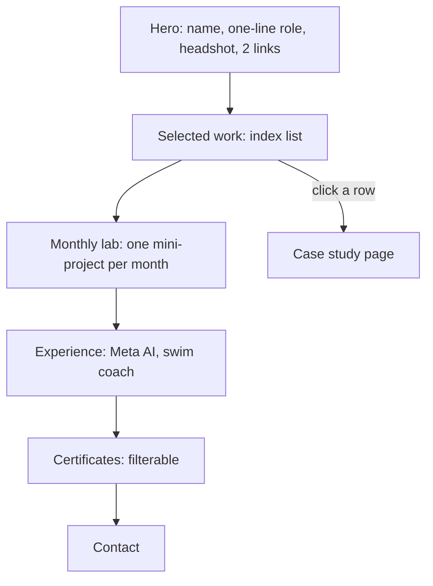

# Portfolio Redesign Brief (for Antigravity)

Goal: a quiet, editorial portfolio that looks hand-made, not AI-generated. Case studies are the main content.

## Principles
1. Content first. Big type, lots of white space, one accent colour.
2. Projects are an index (a list), not a wall of cards.
3. Every project opens a case study with the same 5 blocks (see `content/_template.json`).
4. Phone first. Tap targets 44px or more. No sideways scroll.
5. Status shown in text, not colour alone.
6. No new heavy libraries. Plain HTML, CSS, JS. Reuse the tokens in `style.css`.

## Avoid (looks AI-made)
- Gradients, glow, glassmorphism, neon buttons, emoji in headings.
- Identical rounded cards with the same shadow.
- Filler words such as "elevate", "seamless", "cutting-edge".
- Fake stats. Every number must come from the owner.

## Layout

- **Selected work (index list):** one row per project: number, title, year, 3 tags, status text. Hover or tap shows the preview image. Whole row is the link.
- **Monthly lab:** a timeline, newest first. Each month: title, type (game / tool / experiment), one image, link.
- **Case study page:** The Brief and Goal, Role and Team, The Process, Quantifiable Impact, Visuals. Prev / Next project links at the bottom.
- **Dark and light theme:** keep the existing toggle.

## Type and colour
- Headings: Space Grotesk. Body: Inter (already loaded).
- Neutral background, near-black text, one accent. The owner picks the accent (default: keep the current one, toned down).
- Max text width 68ch. Case-study images full width, with a caption.

## Done when
- Lighthouse accessibility 95 or more on phone.
- Works at 360px width with no horizontal scroll.
- Every project has all 5 blocks filled by real answers, or is not listed yet.
